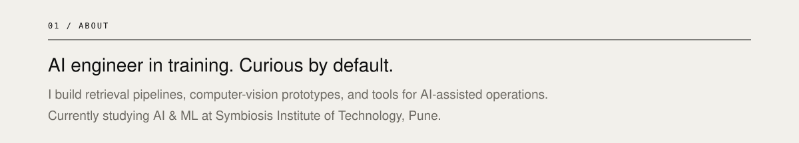
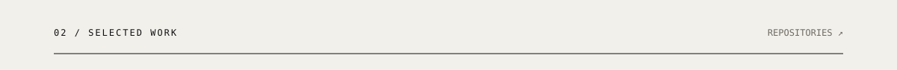
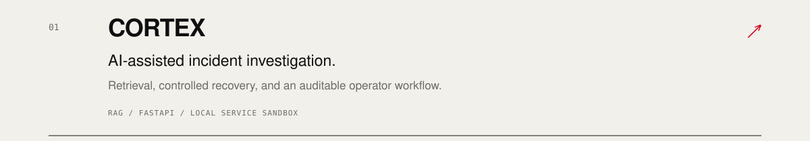
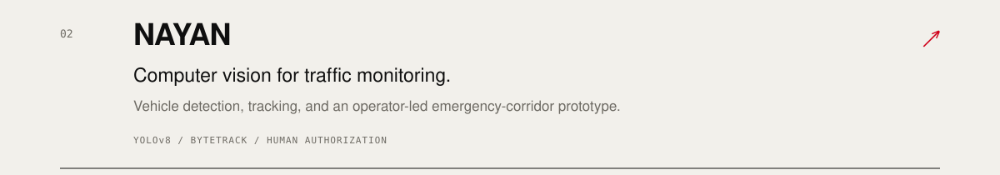
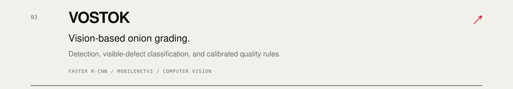
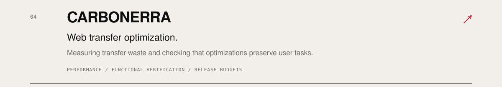
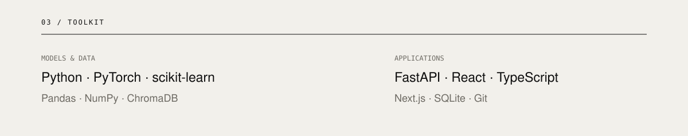
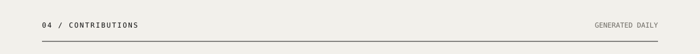
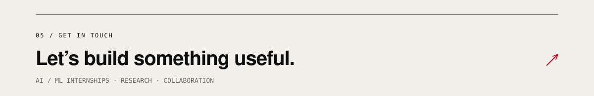

<!-- Swiss Grid adapted from beydemirfurkan/awesome-github-profile. See THIRD_PARTY_NOTICES.md. -->
<picture></picture>
 

 

 

 

 

 

 

 

 

 

[LinkedIn ↗](https://www.linkedin.com/in/ganesh-nair-8ab1a5378/) &nbsp; · &nbsp; [All repositories ↗](https://github.com/GaneshNair007?tab=repositories)

Profile design & credits

Based on the [Swiss Grid template](https://github.com/beydemirfurkan/awesome-github-profile/tree/main/templates/11-swiss-brutalist/swiss-grid), personalized for Ganesh Nair and extended across the profile. Contribution animation: [Platane/snk](https://github.com/Platane/snk). [License notices](./THIRD_PARTY_NOTICES.md).

