# Hi there, I'm Ganesh Nair 👋
### Systems Engineer · AI Architect · Open Source Contributor

  
  
  
  

---

### 🚀 About Me & Engineering Focus

I am a B.Tech Artificial Intelligence & Machine Learning undergraduate at **Symbiosis Institute of Technology (SIT), Pune**, specializing in high-throughput backend systems, autonomous agent architectures, and computer vision.

My engineering philosophy centers on **software honesty, rigorous testing, and verifiable execution**. I focus on:
- ⚡ **Low-Latency Systems & Concurrency**: Designing non-blocking async runtimes with Python (`asyncio`), FastAPI, WebSockets, and deterministic priority queues.
- 🤖 **Autonomous AI & Protocols**: Engineering Model Context Protocol (FastMCP) servers, 3-tier intelligent routing (deterministic regex bypass → local quantized SLMs → cloud reasoning models), and persistent SQLite memory graphs.
- 👁️ **Computer Vision & Edge ML**: Building diagnostic vision pipelines (crop pathology classification, intelligent traffic corridors) using PyTorch, OpenCV, and transfer learning.
- 🧪 **Engineering Rigor**: Practicing test-driven development (`pytest`), cryptographic audit trails (Merkle trees), and reproducible CI/CD pipelines.

---

### 🌟 Featured Open-Source Projects

<table>
  <tr>
    <td width="50%" valign="top">
      <h3><a href="https://github.com/GaneshNair007/Jarvis">🏛️ Jarvis</a></h3>
      
<b>Autonomous Personal AI Operating System, 105-Agent Workforce & 10-Layer Security Shield</b>

      <ul>
        <li><b>105-Agent Autonomous Workforce:</b> Parallelized micro-agent fleet across 5 specialized divisions (Recon, Analysis, Scaffolding, DevOps, Dispatch) with task graph DAG scheduling.</li>
        <li><b>10-Layer Zero-Leak Security Shield:</b> Hardware-accelerated AES-256-GCM vault, Presidio DLP secret redaction, fail-closed cloud router, single-use bound tokens, and append-only Merkle audit ledger.</li>
        <li><b>Aider-Style AST Codebase Knowledge Graph:</b> Real-time symbol table parsing and structural dependency mapping for zero-hallucination code generation.</li>
        <li><b>Asymmetric Hybrid Edge Compute:</b> NVIDIA RTX 4050 6GB local acceleration for Kokoro-TTS and Faster-Whisper voice, paired with multi-account Gemini and OpenRouter rotators.</li>
      </ul>
      

        
        
        
        
        
      

      <a href="https://github.com/GaneshNair007/Jarvis"><b>Explore Jarvis Repository ↗</b></a>
    </td>
    <td width="50%" valign="top">
      <h3><a href="https://github.com/GaneshNair007/calmqueue">⚡ calmqueue</a></h3>
      
<b>Local-First Open-Weight Notification Priority Engine</b>

      <ul>
        <li><b>Notification Intelligence:</b> Compresses 28+ noisy daily alerts into 3 quiet, high-leverage action digests.</li>
        <li><b>Privacy-First Local SLM:</b> Zero cloud egress; all priority evaluations run locally on open-weight models.</li>
        <li><b>Open-Source Milestone:</b> Architected and launched for <b>Hacktoberfest 2026</b> (Week 3: Slow and Steady).</li>
      </ul>
      

        
        
        
      

      <a href="https://github.com/GaneshNair007/calmqueue"><b>Explore calmqueue Repository ↗</b></a>
    </td>
  </tr>
  <tr>
    <td width="50%" valign="top">
      <h3><a href="https://github.com/GaneshNair007/AURA">🤖 AURA</a></h3>
      
<b>Autonomous AI Technical Interviewer & FastMCP Engine</b>

      <ul>
        <li><b>Dynamic Assessments:</b> Tracks a candidate's 31-day learning journey to run context-aware, adaptive technical interviews.</li>
        <li><b>FastMCP Backend:</b> Hallucination-resistant evaluation engine built with the Model Context Protocol (MCP) standard.</li>
        <li><b>Zero-Hallucination Scoring:</b> Grounded evaluation metrics with structured diagnostic output.</li>
      </ul>
      

        
        
        
      

      <a href="https://github.com/GaneshNair007/AURA"><b>Explore AURA Repository ↗</b></a>
    </td>
    <td width="50%" valign="top">
      <h3><a href="https://github.com/GaneshNair007/PCCOE-HACKATHON">🌍 Carbonerra Savings Lab</a></h3>
      
<b>Evidence-Driven Web Sustainability & Regression Guard</b>

      <ul>
        <li><b>Measure & Diagnose:</b> Measures transfer size across browser journeys and maps reducible asset hotspots to source files.</li>
        <li><b>Task-Preserving Optimization:</b> Rejects smaller builds when functional assertions fail, so performance savings do not come at the cost of broken user workflows.</li>
        <li><b>Regression Protection:</b> Promotes verified transfer budgets into a shared evaluator used by the app, CLI, and GitHub Actions; repository README documents 28 tests.</li>
      </ul>
      

        
        
        
        
      

      <a href="https://github.com/GaneshNair007/PCCOE-HACKATHON"><b>Explore Carbonerra Repository ↗</b></a>
    </td>
  </tr>
  <tr>
    <td width="50%" valign="top">
      <h3><a href="https://github.com/GaneshNair007/CORTEX-CLOUD-AUTOPILOT-">☁️ CORTEX Cloud Autopilot</a></h3>
      
<b>AI-Assisted Operations & Incident Recovery Sandbox</b>

      <ul>
        <li>Automated incident triage and root cause investigation in a secure cloud sandbox.</li>
        <li>Policy-controlled auto-recovery workflows with guardrailed execution limits.</li>
      </ul>
      

        
        
      

      <a href="https://github.com/GaneshNair007/CORTEX-CLOUD-AUTOPILOT-"><b>Explore CORTEX Repository ↗</b></a>
    </td>
    <td width="50%" valign="top">
      <h3><a href="https://github.com/GaneshNair007/ibm-x-quantum-computing-">⚛️ QuantumRescue</a></h3>
      
<b>Hybrid Classical–Quantum Disaster Intelligence & Logistics Platform</b>

      <ul>
        <li><b>Disaster Image Intelligence:</b> ResNet-18 feature extraction with a four-qubit variational quantum classifier using Qiskit Aer simulation.</li>
        <li><b>Operational Logistics:</b> Google OR-Tools CP-SAT handles vehicle capacity and regional demand constraints; QAOA is kept as an explicitly experimental research track.</li>
        <li><b>Safety & Integrity:</b> Human approval gates dispatch and stock reservations; the README documents database invariants, quarantined image ingestion, and reproducible verification scripts.</li>
      </ul>
      

        
        
        
        
      

      <a href="https://github.com/GaneshNair007/ibm-x-quantum-computing-"><b>Explore QuantumRescue Repository ↗</b></a>
    </td>  </tr>
  <tr>
    <td width="50%" valign="top">
      <h3><a href="https://github.com/GaneshNair007/SIH">🧪 H₂S Monitor Platform</a></h3>
      
<b>Industrial Hydrogen Sulfide Exposure Tracking</b>

      <ul>
        <li><b>Exposure History:</b> Tracks cumulative H₂S exposure across shifts and colorimetric wristband lifecycles.</li>
        <li><b>Scientific Caution:</b> Displays exposure as ranges and includes scan-confidence states instead of presenting false measurement precision.</li>
        <li><b>Role-Based Workflows:</b> Separate worker and shift-manager dashboards for exposure history, active workers, and wristband registration. The repository identifies its data as simulated demo data.</li>
      </ul>
      

        
        
        
      

      <a href="https://github.com/GaneshNair007/SIH"><b>Explore H₂S Monitor Repository ↗</b></a>
    </td>
  </tr>
</table>

---

### 🎯 Google Summer of Code (GSoC 2027) Preparation & Open Source Track

I am actively building towards Google Summer of Code contributions with a strong foundation in systems programming, concurrency, and applied machine learning:

- **Target Organizations**:
  - 🐍 **Python Software Foundation (PSF)**: Core runtime ergonomics, asynchronous event loops (`asyncio`), and package ecosystem tooling.
  - 🔢 **NumFOCUS**: High-performance scientific computing libraries (NumPy, SciPy, Pandas) and vector data operations.
  - 🦚 **Red Hen Lab**: Multimodal audio/video parsing, automated speech feature extraction, and computer vision indexing pipelines.
  - 🧠 **TensorFlow / Keras / SymPy**: Graph compilation, symbolic computing, and edge deployment pipelines.
- **Core Engineering Disciplines**:
  - **Git Hygiene**: Semantic commits (`feat:`, `fix:`, `test:`, `docs:`), clean rebasing, and atomic pull requests.
  - **Test Coverage**: Comprehensive unit, integration, and mocking suites with `pytest` and code coverage tracking.
  - **Type Safety & Code Quality**: Strict type hints (`typing`), Ruff / Black formatting, and CI/CD lint automation.

---

### 🛠️ Technical Stack & Tooling

| Category | Tools, Languages & Frameworks |
| :--- | :--- |
| **Languages** | `Python (3.11+, Asyncio)` · `TypeScript` · `C` · `SQL` · `Bash / Shell` |
| **AI / ML & Vision** | `PyTorch` · `OpenCV` · `Scikit-Learn` · `Transformers` · `ChromaDB` · `LiteLLM` |
| **Backend & Architecture** | `FastAPI` · `Uvicorn` · `WebSockets` · `FastMCP (Model Context Protocol)` · `RESTful APIs` |
| **Databases & Storage** | `SQLite (WAL mode)` · `PostgreSQL` · `Redis` · `Pandas / NumPy` |
| **DevOps, CI/CD & Testing** | `Git / GitHub Actions` · `Pytest` · `Docker` · `Linux / WSL` · `Pre-commit` |

---

### 📊 GitHub Activity & Analytics

  
  

  

#### 🐍 Contribution Timeline
 

 

<i>"Continuous learning and honest engineering, one commit at a time."</i>

---

### 📬 Connect With Me

**Symbiosis Institute of Technology (SIT), Pune, India**

